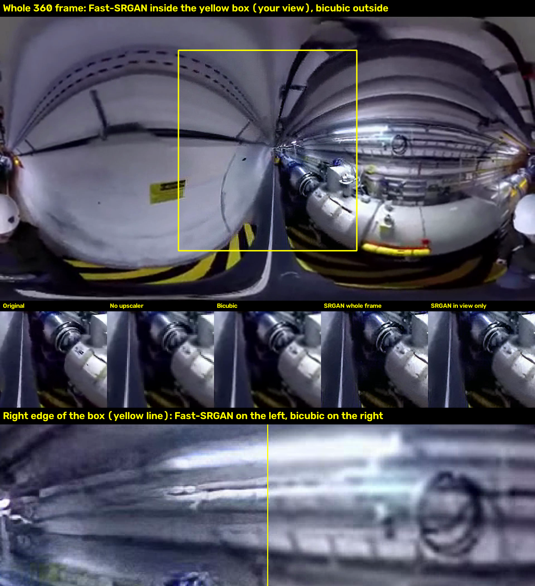

# Low-res 360° streaming + on-device upscaling (Fast-SRGAN)

**Question:** if a VR / 360° video is streamed at ¼ resolution and upscaled on the viewer's device, how much bandwidth
does that save — and what does upscaling with a GAN ([Fast-SRGAN](https://github.com/HasnainRaz/Fast-SRGAN)) cost in
GPU, memory, speed and image quality compared with simple upscalers and with just streaming full resolution?

Everything here runs on one machine (tested on an Apple M4 Mac mini) and is reproducible with two commands.
It includes a live 360° viewer that runs each technique in real time and graphs CPU, RAM and GPU as you switch.

## Findings (test clip, M4 Mac mini)

| | Stream | Upscale time | Visible-region PSNR | Extra GPU memory | GPU busy* |
|---|---:|---:|---:|---:|---:|
| Full-res stream (baseline) | 3,069 kbps | — | 42.3 dB | — | ~0–12% |
| Full-res stream, visible region only | 1,046 kbps | — | 40.6 dB | — | ~0–11% |
| Low-res stream + bicubic | **531 kbps** | 1.0 ms | 31.0 dB | — | ~0–11% |
| Low-res stream + Fast-SRGAN, whole frame (fp16) | **531 kbps** | 132 ms ✗ | 27.5 dB | ~1.05 GB | 92% |
| Low-res stream + Fast-SRGAN, visible region only (fp16) | **531 kbps** | 32 ms ✓ | 28.1 dB | ~1.06 GB | 80% |

\* Above the idle level. The non-GPU rows read 0% in one run and 10–12% in another, i.e. background noise; Fast-SRGAN was 79–92% in both.

1. **Streaming at ¼ resolution cuts bandwidth ~5.8×** (≈1.38 → 0.24 GB per hour). That saving comes from the
   low-res stream itself, so every upscaler shares it.
2. **Fast-SRGAN needs a GPU and ~1 GB of extra memory, and on the whole frame it isn't real time** (≈7–9 fps on the M4).
   Upscaling only the visible 120°×120° region makes it real time for 1080p video; 4K/8K would need foveated
   (eye-tracked) upscaling — see the crop-size table in [results/RESULTS.md](results/RESULTS.md).
3. **It looks sharper but scores lower than bicubic** on PSNR/SSIM and flickers ~70% more frame-to-frame, because
   GAN detail is invented and computed independently per frame.
4. **At equal bandwidth, shrink-then-bicubic beat full resolution squeezed to the same bitrate** (31.8 vs 30.0 dB),
   so low-res streaming plus cheap upscaling is a real win on its own.

Full tables (speed, quality, CPU/RAM/GPU, crop sizes): **[results/RESULTS.md](results/RESULTS.md)** — raw JSON in `results/data/`.



## Quick start

Needs Python 3.10+, git, and curl. macOS (Apple silicon) or Linux; an NVIDIA GPU (CUDA) also works, CPU-only works but
Fast-SRGAN is very slow there.

```bash
git clone <this repo> && cd <repo>
./setup.sh            # venv, PyTorch, Fast-SRGAN (pinned commit), ffmpeg, test clip  (~2 min)
./run_benchmarks.sh   # every experiment → results/RESULTS.md                       (~5 min on an M4)
./live.sh             # live viewer → http://localhost:8766/viewer.html
```

On macOS you can instead double-click `setup.command`, `run_benchmarks.command` and `live.command` in Finder.

### Live viewer (`./live.sh`)

* Keys **1–9** switch technique; the Mac decodes, upscales and streams frames to the page in real time.
* Left panel: live value + 2-minute graph for stream bitrate, processing time vs. frame budget, frames delivered,
  dropped frames, CPU, RAM, GPU busy, GPU memory, frame-sending overhead, plus the benchmark's quality scores.
* **Video** row: pick a clip or **Upload video** (any 2:1 equirectangular 360° file; first 15 s are used, >3840 px wide is scaled down).
  `./get_samples.sh` downloads one more sample clip.
* **D** stats panel · **T** comparison table · **V** outline of the 120° region · **H** hide controls · drag to look, scroll to zoom.
* An **Enter VR** button appears in WebXR-capable headset browsers.

`./serve.sh` serves the *recorded* viewer instead (pre-rendered output videos from the benchmark, with side-by-side split view).

## What is measured

| Script | What it does |
|---|---|
| `bench.py` | Shrinks the clip ×4, encodes it (so codec artifacts are included), upscales with none / bicubic / Lanczos / Fast-SRGAN (optionally only the visible region), and scores speed, PSNR, SSIM and flicker (whole frame and visible 120° region). `--match-bitrate` also encodes full resolution at the low-res bitrate. |
| `native_vp.py` | Full-resolution stream of only the visible region (viewport streaming, no upscaler). |
| `resources.py` | Plays one technique at the video's frame rate in a fresh process and records CPU, RAM, GPU memory and GPU utilisation. |
| `crop_speed.py` | Fast-SRGAN time and memory for viewport / fovea crop sizes of 1080p, 4K and 8K 360° video. |
| `make_report.py` | Turns all of the above into `results/RESULTS.md`. |
| `live_server.py` + `viewer.html` | The live viewer. |

Definitions: *flicker* = mean absolute frame-to-frame change in the output that the original doesn't have.
*Visible region* = the centred 120°×120° part of the equirectangular frame (a 90° headset view plus head-motion margin).

## Limitations

* One short (7.5 s), already-soft 1080p test clip; a sharper 4K source would give upscalers more real detail to recover.
* PSNR/SSIM penalise GAN output; a perceptual metric (e.g. LPIPS) or a user study would be fairer to Fast-SRGAN.
* Fast-SRGAN uses InstanceNorm, so a crop is normalised differently from the full frame: upscaling only the visible region
  leaves a visible brightness/texture seam at its edge (see the image above), and tiled 4K/8K runs can show tile edges.
* Resource numbers are from one machine. GPU utilisation is read from `ioreg` and is only available on macOS.
  On a Mac the GPU shares RAM with the CPU, so "RAM + GPU memory" is the true total.
* The live viewer adds a JPEG encode per frame (shown separately) to send frames to the browser.
* The visible region is fixed straight ahead; there is no head tracking or network simulation.

## Credits

* [Fast-SRGAN](https://github.com/HasnainRaz/Fast-SRGAN) by Hasnain Raza (MIT) — cloned by `setup.sh` at a pinned commit, not redistributed here.
* Test clip `pano.mp4` from the [three.js](https://github.com/mrdoob/three.js) examples; viewer built with three.js (MIT).
* Optional sample `vr_bench_man.mp4` from Brandon Jones' [webvr.info](https://github.com/toji/webvr.info) samples.
* Videos are downloaded by the scripts, not included in this repository.

## License

MIT — see [LICENSE](LICENSE).
